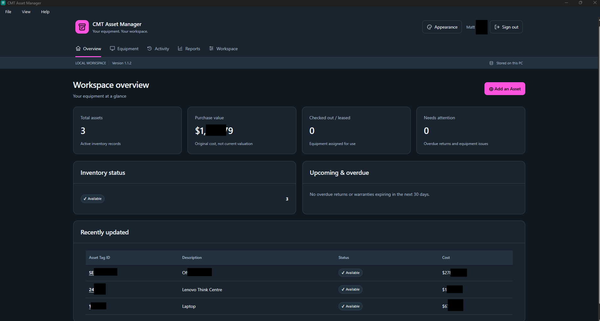
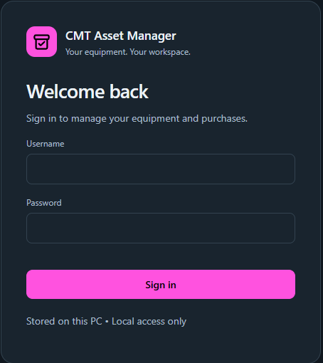
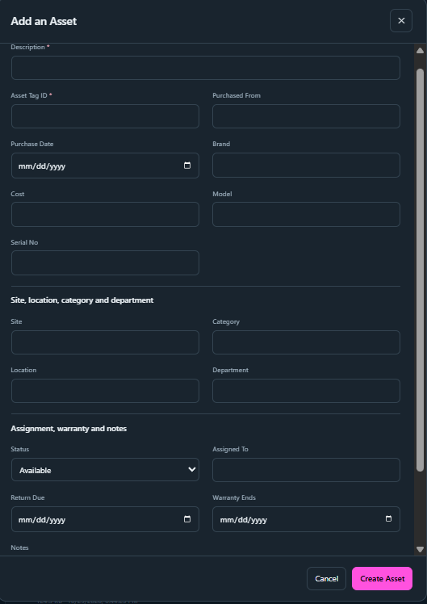
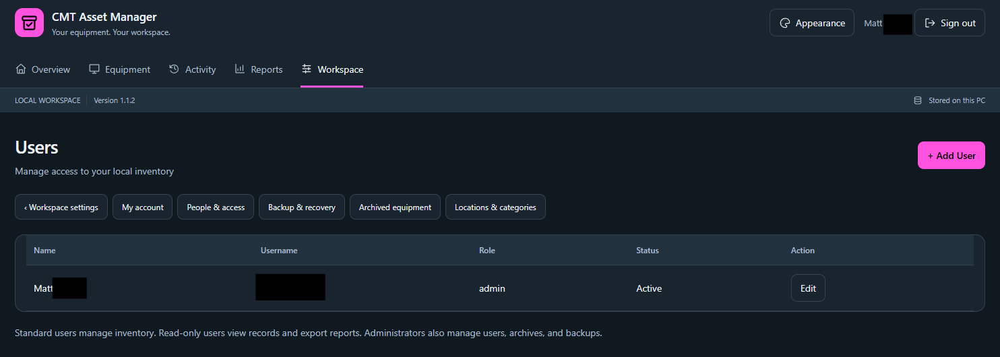
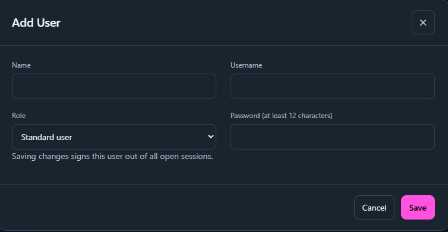
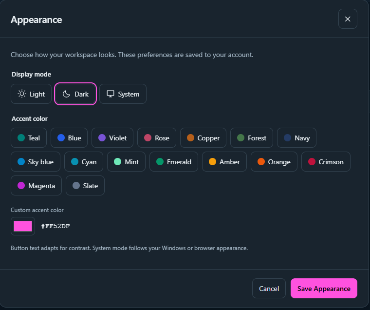
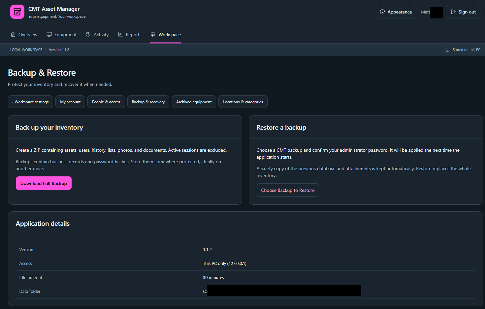

# CMT Asset Manager

**Version 1.1.2 | Local-first Windows inventory and asset management**

CMT Asset Manager is a desktop application developed by **Cyber Matt Technologies** for keeping track of equipment, assignments, and inventory records without requiring a cloud account. It combines a Python/FastAPI backend, SQLite storage, and a PySide6 desktop interface with HTML, CSS, and JavaScript.

## Download for Windows

**[Download the latest Windows release](https://github.com/mattemiles/Inventory-Management-System/releases/latest)**

On the release page, expand **Assets** and download `CMT_Asset_Manager_Setup_1.1.2.exe` for version 1.1.2. The release also includes `SHA256SUMS.txt`, which you can use to verify the installer download.

1. Download the Windows installer from the Releases page.
2. Run the installer and follow the setup prompts.
3. Launch CMT Asset Manager and complete the initial administrator account setup.
4. See [`USER_GUIDE.txt`](USER_GUIDE.txt) for usage instructions.

The packaged Windows application does **not** require a separate Python installation or cloud account. The installer is not digitally signed, so Windows may display an unknown-publisher warning. Only install software from a source you trust, and verify the checksum when possible.

## Screenshots

### Workspace dashboard

View an overview of inventory, purchases, assigned equipment, and recently updated assets.

### Sign-in screen

Access the application through its local sign-in interface.

### Add an asset

Record equipment details, categories, purchasing information, assignment status, and notes.

### User management

Manage application users and their roles.

### Add a user

Create local accounts with an assigned role.

### Appearance settings

Choose light or dark mode and customize the accent color.

### Backup and restore

Create inventory backups and restore data from a backup file.

## Features

- Equipment inventory, categories, assignments, and asset history
- Multiple user accounts and roles
- Image and document attachments, with photo previews and PDF viewing
- CSV import and Excel/CSV export
- Backup and restore
- Light/dark modes, appearance presets, and custom accent colors
- Packaged Windows desktop application with an offline-capable installer
- Local application data storage without a required cloud service

## Technology stack

| Component | Technology |
| --- | --- |
| Backend | Python 3.12, FastAPI |
| Data storage | SQLite |
| Desktop shell | PySide6 |
| Interface | HTML, CSS, JavaScript |
| Packaging | PyInstaller, Inno Setup |

## Build the Windows installer (maintainers)

1. On a **Windows x64** PC, install **Python 3.12 (64-bit)** and **Inno Setup 6.3 or newer**.
2. Clone or download this repository to a regular local folder.
3. Run `BUILD_INSTALLER.bat` from the repository root. The script creates an isolated environment, installs dependencies, runs validation, and builds the installer. Internet access is required to download dependencies during the build.
4. Look in `output/` for the installer, `SHA256SUMS.txt`, and `BUILD_INFO.json`.
5. Complete [`WINDOWS_CHECKLIST.txt`](WINDOWS_CHECKLIST.txt) before distributing a newly built installer.

For details, see [`START_HERE.txt`](START_HERE.txt) and [`VALIDATION.md`](VALIDATION.md).

## Project structure

| Path | Purpose |
| --- | --- |
| `app.py`, `paths.py`, `recovery.py`, `previews.py` | Backend and data-handling logic |
| `desktop.py`, `launcher.py`, `run.py` | Desktop integration and entry points |
| `static/` | Frontend HTML, CSS, and JavaScript |
| `assets/` | Application icons and images used by the program |
| `Screenshots/` | Screenshots for the repository README |
| `tests/` | Automated tests |
| `tools/` | Build and smoke-test tooling |
| `installer/` | Inno Setup configuration |
| `USER_GUIDE.txt` | End-user instructions |

## Data and security

CMT Asset Manager stores inventory data under the Windows user profile, separately from the installed application. The local web service binds to the loopback interface and requires authentication. Back up your data before major upgrades.

**Never commit real application databases, account information, attachments, backups, or local secrets to this public repository.** Use sample or anonymized data in documentation and screenshots.

## License and third-party notices

Consult the repository's top-level [`LICENSE`](LICENSE) for the terms that apply to this project. Qt/PySide third-party notices are documented in [`QT_NOTICES.txt`](QT_NOTICES.txt) and `licenses/`. These third-party notices do not replace the project's own license.

## Developer

**Cyber Matt Technologies**  
[GitHub profile](https://github.com/mattemiles) · [All releases](https://github.com/mattemiles/Inventory-Management-System/releases)
